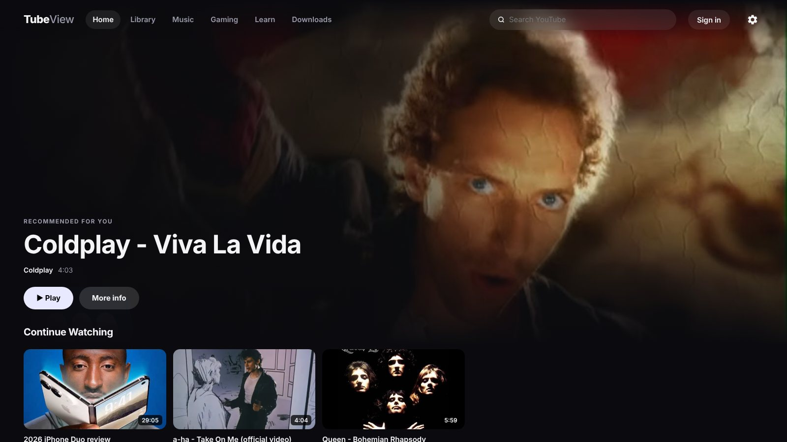
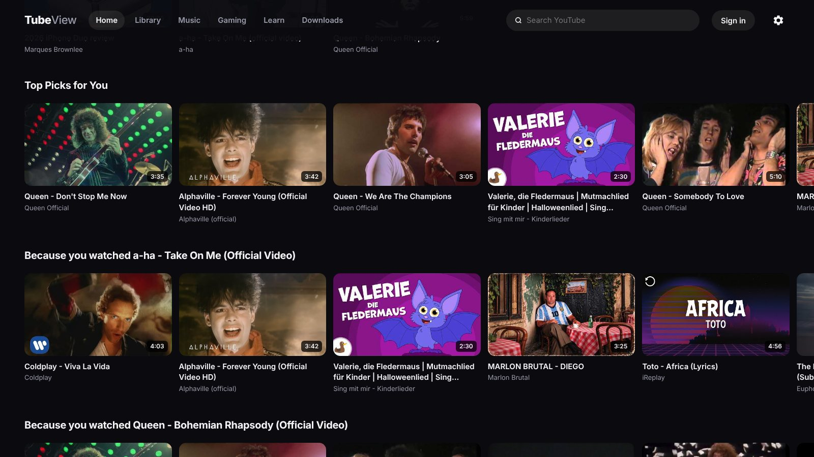
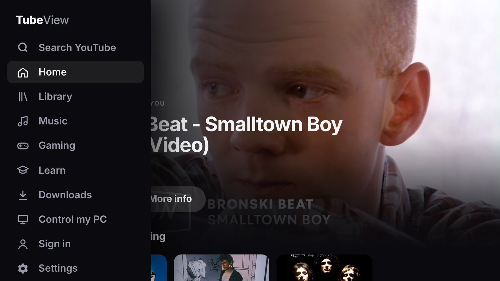
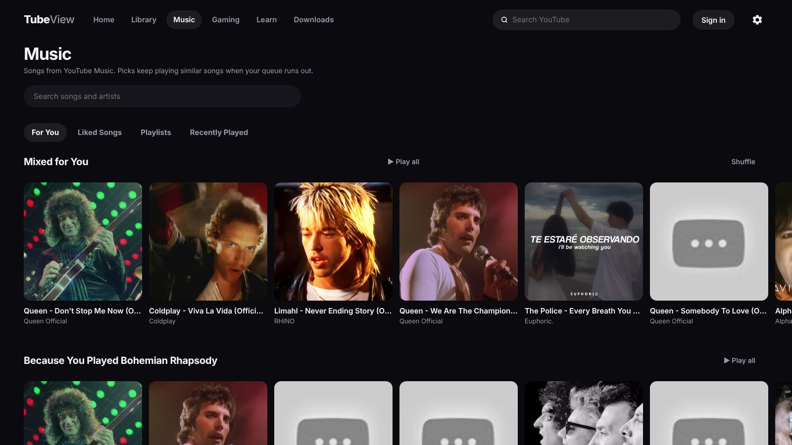
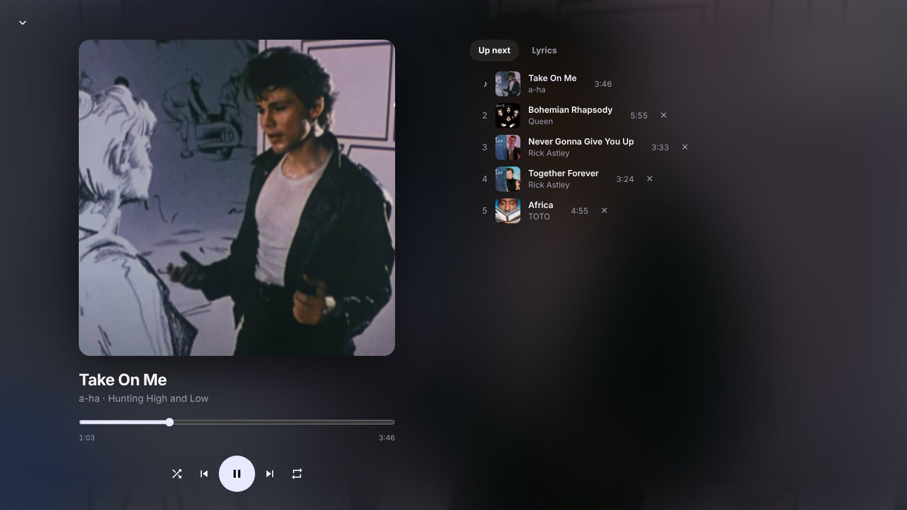
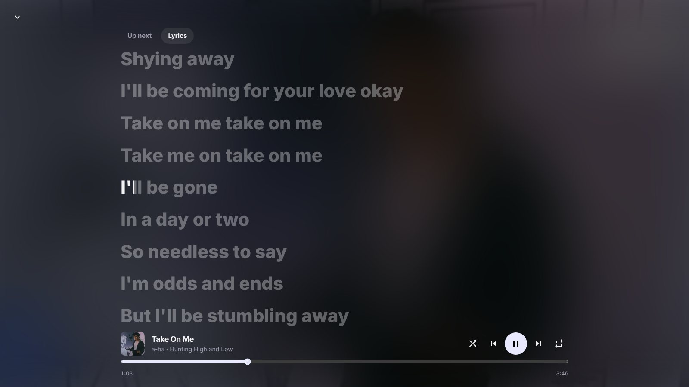
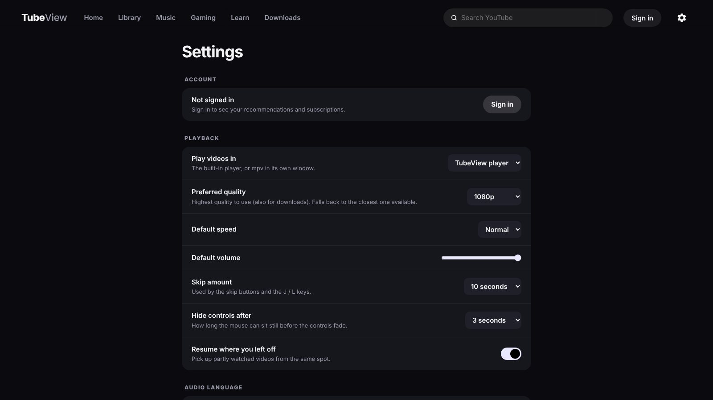
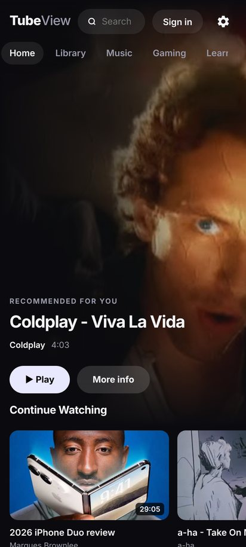
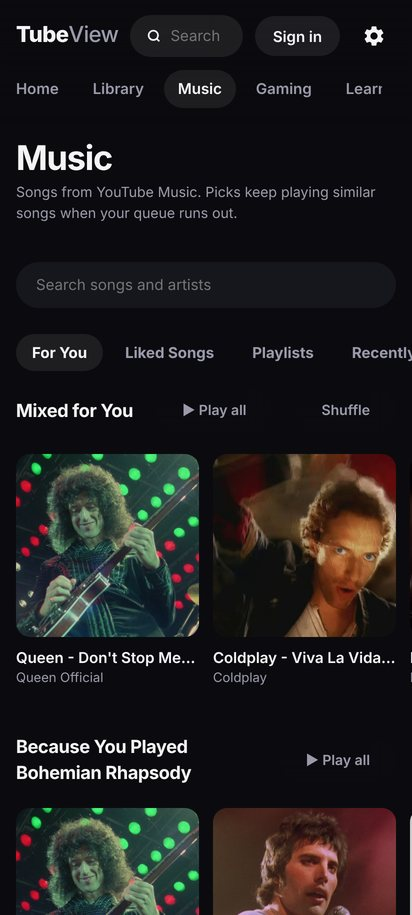
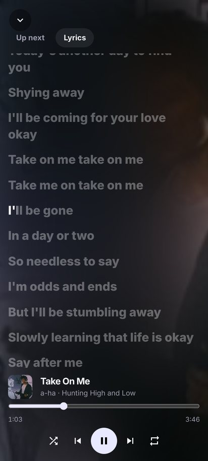

# TubeView

A YouTube and YouTube Music client with a dark, poster-style interface, for Android phones, foldables, Android TV,
Android Auto and Linux. It has its own video player and music player, word-by-word lyrics, your real YouTube
recommendations, SponsorBlock, downloads, background play and picture-in-picture, and no ads.

**Download the latest release:**

- **[TubeView-android.apk](../../releases/latest/download/TubeView-android.apk)** for phones, foldables, TVs and cars
- **[TubeView-x86_64.AppImage](../../releases/latest/download/TubeView-x86_64.AppImage)** for Linux

Release notes and any test builds are on the [releases page](../../releases).

<p align="center">
  
</p>

> TubeView is an independent, unofficial app. It is not affiliated with, endorsed by, or connected to Google, YouTube
> or YouTube Music.

## Contents

- [Screenshots](#screenshots)
- [Features](#features)
- [Android TV](#android-tv)
- [Phones and foldables](#phones-and-foldables)
- [In the car](#in-the-car)
- [Signing in](#signing-in)
- [Linux](#linux)
- [Phone remote](#phone-remote)
- [Keyboard](#keyboard)
- [Building it yourself](#building-it-yourself)
- [How it works](#how-it-works)
- [Your data](#your-data)
- [Credits](#credits)

## Screenshots

<table>
  <tr>
    <td width="50%"></td>
    <td width="50%"></td>
  </tr>
  <tr>
    <td>Recommendations: Top Picks and "Because you watched" rows</td>
    <td>Android TV: a side menu and a bigger layout you drive with the remote</td>
  </tr>
  <tr>
    <td></td>
    <td></td>
  </tr>
  <tr>
    <td>Music: For You, Liked Songs, Playlists and Recently Played</td>
    <td>The music player and its queue</td>
  </tr>
  <tr>
    <td></td>
    <td></td>
  </tr>
  <tr>
    <td>Lyrics fill the screen and light up word by word</td>
    <td>Settings</td>
  </tr>
</table>

<p align="center">
  
  
  
</p>

## Features

### Videos

- **Your YouTube home page.** With the YouTube TV sign-in, Home shows the rows YouTube picks for you. Without it,
  Home builds its own picks from YouTube's mixes of what you watched.
- **Subscriptions, library and actions.** New uploads from your channels, your channel list, Liked videos, History,
  Watch Later and your playlists, plus Like, Subscribe and Save to playlist.
- **Its own player** with exact seeking, subtitles (with size and background settings), chapters, seek-bar previews,
  playback speed, dubbed audio tracks and a sleep timer. On Android, videos play in the system player with hardware
  decoding.
- **Auto quality** starts a step below the best quality so videos start sooner, then steps up once playback is
  smooth (and down if it stalls). Or pick a quality yourself.
- **SponsorBlock**: skip sponsors, intros, reminders to subscribe and more, automatically or with a button.
- **DeArrow**: community-written titles and thumbnails in place of clickbait ones.
- **Return YouTube Dislike** estimates in video details.
- **Downloads** of videos and audio, kept in the app's Downloads page.
- **Search** with filters (date, type, length, sort), channel pages with their Videos, Shorts, Live and Playlists
  tabs, and an option to hide Shorts everywhere.
- **Background play and picture-in-picture** on Android: a video keeps playing when you leave the app or the screen
  turns off, with controls in the notification, or carries on in a small window.

### Music

- **Songs from YouTube Music**, with search, Liked Songs, playlists and Recently Played.
- **For You** is built from what you play: YouTube Music's radios of your recent songs, mixed together, then
  "Because you played" rows and more from the artists you play most.
- **Endless listening**: when the queue runs out it carries on with similar songs.
- **Lyrics from six services**: Apple Music (through Better Lyrics), LyricsPlus, KuGou, NetEase, LRCLIB and Genius.
  Word-by-word lyrics are preferred, then line-timed, then plain text. Lyrics for another edit of the song are
  skipped, and the source is shown under the lyrics.
- **Full-screen lyrics** in the music player, and with the Lyrics button in the Android video player for music
  videos, with the controls along the bottom.
- **Crossfade, volume levelling**, shuffle and repeat, and media controls in the notification, on the lock screen
  and on Android TV's "Now playing" card.

### Everywhere

- **Quick starts**: Home appears at once from what was shown last time and refreshes in the background, and on
  Android videos and music start from a single request.
- **One interface, sized for each screen**: a mouse-and-keyboard layout on the desktop, touch on phones, a TV layout
  for the remote, and a compact layout for small screens such as a foldable's outer screen.
- **TubeView playlists** of videos and songs, separate from your YouTube ones.
- **Accent colours, card sizes**, reduced motion and other appearance settings.

## Android TV

TubeView is in the TV's launcher and switches to its TV layout on its own: bigger text and cards, and everything is
reachable with the remote's arrow keys. Pages sit beside a menu down the left side, which opens out with labels when
you press Left at the edge of the page or Back, and Right takes you back to where you were. The search box brings up
the keyboard only when you press OK, so moving past it never gets stuck. Music keeps playing after you press Home, and shows on the TV's "Now playing"
card. To sign in, TubeView shows a code to enter on your phone.

## Phones and foldables

- Videos play in Android's own player, with picture-in-picture and background play (both can be turned off in
  **Settings → Leaving the app**).
- Folding, unfolding or resizing keeps playback going and reflows the layout. The outer screen of a foldable gets a
  compact layout.
- **Remote control** finds TubeView on your TV or computer over Wi-Fi and turns the phone into its remote.
- Voice: "Hey Google, play *a song or artist* on TubeView" searches and plays it.
- Video downloads on Android are 360p single files (audio downloads are full quality), because there is no ffmpeg on
  the phone to merge separate video and audio.

## In the car

Android Auto can show TubeView in one of two ways. Pick one in **Settings → Android Auto → Android Auto shows TubeView
as**, then disconnect your phone from the car and connect it again.

- **Music app** (the default): TubeView appears among Android Auto's media apps. Browse For You, Liked Songs,
  Recently Played and Explore, or search, on the car's screen. It is safe to use while driving, plays on the phone
  with TubeView closed and the phone locked, and carries on with similar songs when the list runs out.
- **Full app with videos**: Android Auto opens TubeView's own screen instead, the same one as on your phone, so
  videos can play on the car's display when you are parked (Android 15 and later). While the car moves (judged from
  the phone's GPS speed) videos pause and the screen is covered; music keeps playing. TubeView needs location
  permission for this and treats the car as moving without it. This uses an approach Android Auto does not
  officially support, so an Android Auto update may stop it working.

Android Auto only lists apps from the Play Store unless you turn on **Unknown sources**: in Android Auto's settings,
tap the version number ten times, then open the developer settings from the menu and turn it on.

Do not watch videos while driving.

## Signing in

**Sign in → Sign in with YouTube TV** signs in the way YouTube's own TV app does (as SmartTube and NewTube do). You
get a code to enter at the address shown, on your phone or computer. It gives your YouTube recommendations,
subscriptions, likes, playlists, history and Watch Later, and Like, Subscribe and Save to playlist, and the account
button shows your name and picture, with a link to your channel.

This is not an official way for apps to sign in, so YouTube may stop it working; Home then falls back to its own
picks. On Linux you can also use the YouTube login of your web browser instead.

## Linux

Download [`TubeView-x86_64.AppImage`](../../releases/latest/download/TubeView-x86_64.AppImage), make it executable (`chmod +x`) and run it. To run from the source instead:

```sh
./run.sh --window   # TubeView's own window
./run.sh            # or open it in your web browser
```

The first run creates `.venv/` and installs yt-dlp into it. On Arch or CachyOS, install the rest with:

```sh
sudo pacman -S mpv ffmpeg nodejs pyside6 libnotify
```

- **ffmpeg** joins YouTube's separate video and audio into one stream for the player.
- **nodejs** lets yt-dlp solve YouTube's playback challenges.
- **mpv** plays videos in its own window, if you choose that in Settings.
- **pyside6** (Qt WebEngine) draws the app window.
- **libnotify** (`notify-send`) shows alerts for new uploads.

Windows builds are paused for now; you can still build one yourself (below).

## Phone remote

Control TubeView on your TV or computer from your phone. On the TV or computer: **Settings → Phone remote → Allow
phone remote**. Then pair a phone with the code shown, from the Android app (**Remote control**) or any phone browser
at `http://<the TV's or computer's address>:8766`.

- **Videos**: search on the phone and the video plays on the big screen. Play, pause, jump back or forward 10 seconds,
  seek, start over, skip to the next video or close it.
- **Music**: search songs, play or add them to the queue, and play, pause, skip, seek, shuffle, repeat and volume.
- It is off until you turn it on, and only paired phones can control anything.
- If your PC has a firewall, allow TCP and UDP port 8766 on your local network. With ufw: `sudo ufw allow 8766`.

## Keyboard

| Key | Does |
|---|---|
| Space or K | Play or pause |
| J and L | Skip back and forward |
| Left and Right | 5 seconds back and forward |
| Up and Down | Volume |
| M | Mute |
| F | Full screen |
| C | Subtitles |
| I | Mini player |
| P | Picture-in-picture |
| Shift+N | Next video |
| Esc | Close |
| / | Search |
| F5 | Reload the window |

Right-click anything for more, including playlists and the sleep timer. On a TV, the arrow keys move around and Back
closes things.

## Building it yourself

- **Android**: in `android/`, run `gradle assembleRelease` with JDK 17 and Python 3.11. Release builds are signed
  with a key kept in the repository secrets (`ANDROID_KEYSTORE`, `ANDROID_KEYSTORE_PASSWORD`).
- **Linux and Windows**: `pip install pyinstaller "yt-dlp[default]" PySide6`, put `ffmpeg` and `deno` in
  `packaging/bin/`, then run `pyinstaller packaging/tubeview.spec`. Then run `packaging/build_appimage.sh` (Linux),
  or compile `packaging/windows/tubeview.iss` with Inno Setup (Windows).
- **Icons** for every platform come from `python tools/make_icons.py` (needs Pillow).
- **Releases**: the [Build workflow](../../actions/workflows/build.yml) builds on demand. Running it with a version
  publishes a release, and ticking "pre-release" publishes a test build that doesn't replace the latest release.
  Pushing a tag like `v1.0.1` also publishes a release.

## How it works

| File | What it does |
|---|---|
| `tubeview.py` | A local server on `127.0.0.1:8765`: YouTube data, streams, sign-in, lyrics, downloads and alerts |
| `index.html` | The whole interface: pages, video player, music player and settings |
| `android/` | The Android app: it runs the same server inside the app and adds the native player, music service, car support and voice |
| `window.py` | The desktop app window (Qt WebEngine) |
| `remote.html` | The phone remote page, served on port 8766 while Phone remote is on |
| `sponsorblock.lua` | Skips SponsorBlock segments when videos play in mpv |
| `packaging/`, `.github/workflows/` | Desktop packaging and the build workflow |

- YouTube data comes through [yt-dlp](https://github.com/yt-dlp/yt-dlp). On Android, streams come from one player
  request as YouTube's visionOS app, the way [Prism](https://github.com/Yigder/Prism) gets them, with yt-dlp as the
  fallback.
- SponsorBlock and DeArrow are looked up by a hash prefix, so those servers never learn which video you watch.
- The server only answers requests from TubeView itself, so other websites can't use it.

## Your data

Everything stays on your device. On Linux it lives in `~/.config/tubeview/`; on Android, in the app's own storage.

| File | What |
|---|---|
| `data.json` | Settings, Continue Watching, resume points, playlists and music history |
| `youtube-tv.json` | Your YouTube TV sign-in |
| `home-cache.json`, `music-cache.json` | Home rows and music searches, so they show at once |
| `remote.json` | Phone remote pairing code and paired phones |

Downloads go to `~/Videos/TubeView/` on Linux. Back up `data.json` to keep your settings, history and playlists.

## Credits

- [yt-dlp](https://github.com/yt-dlp/yt-dlp) for YouTube data, [ffmpeg](https://ffmpeg.org) for streams and
  [mpv](https://mpv.io) for the optional external player.
- [SponsorBlock](https://sponsor.ajay.app) and [DeArrow](https://dearrow.ajay.app) by Ajay Ramachandran and
  contributors, and [Return YouTube Dislike](https://returnyoutubedislike.com).
- Lyrics from [Better Lyrics](https://betterlyrics.org), LyricsPlus, KuGou, NetEase, [LRCLIB](https://lrclib.net) and
  Genius. Lyrics belong to their rights holders.
- Ideas from [SmartTube](https://github.com/yuliskov/SmartTube) (the YouTube TV sign-in), [Prism](https://github.com/Yigder/Prism)
  (lyrics and streams) and [AA Browser](https://github.com/kododake/AABrowser) (TubeView's screen in Android Auto).
- [Chaquopy](https://chaquo.com/chaquopy/) runs the Python server inside the Android app, and
  [Media3](https://developer.android.com/media/media3) plays video and music there.
